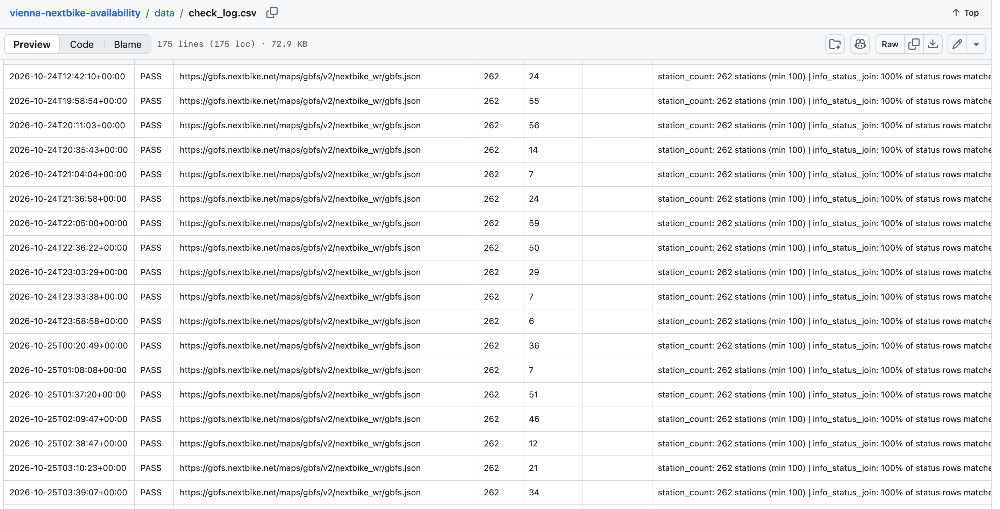
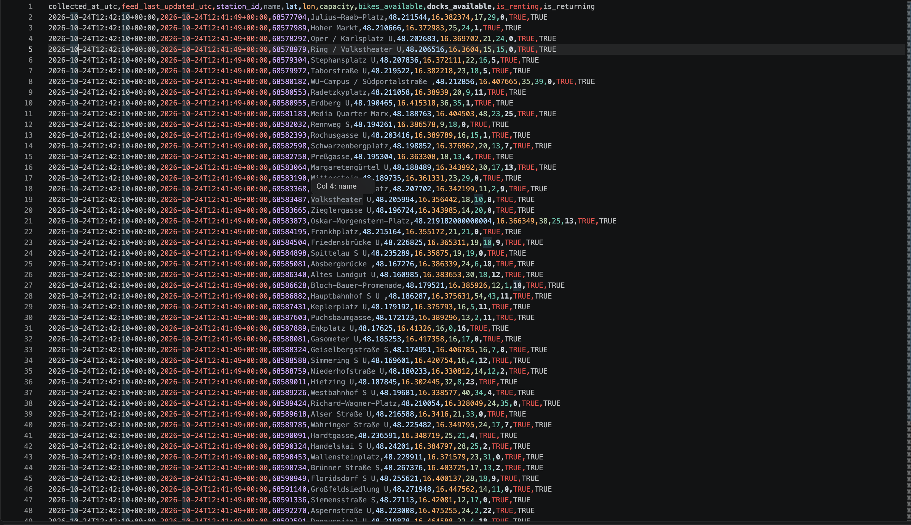

This document explains the automated workflow of our project and collects its code. The workflow collects live availability data of the Vienna bike-share system **WienMobil Rad** (operated by nextbike), checks every time whether the collection succeeded, and analyses the collected data to identify bike stations that frequently run out of bikes. The collection itself runs as a stand-alone script (`update_data.R`) that GitHub Actions starts automatically every 15 minutes. This file walks through that script step by step.

Project folder:

| File | Purpose |
|------------------------------------|------------------------------------|
| `update_data.R` | the script that is scheduled: download, check, save |
| `.github/workflows/collect.yml` | the GitHub Actions workflow that runs the script every 15 minutes |
| `visualisations.R` | charts and map from the collected data |
| `data/snapshots.csv` | one row per station per run (only runs that passed all checks) |
| `data/check_log.csv` | one row per run: PASS or FAIL and why |

The code chunks of the collection script are not evaluated when this file is rendered (`eval: false`), because the script is meant to be run by GitHub Actions. The chunks in the last two sections read the collected files and are only evaluated if these files exist.

```{r}
#| eval: true
#| output: false
library(tidyverse)
library(lubridate)
library(jsonlite)
```

# The task and the idea

Bike-share stations are sometimes empty (no bike to rent). We want to know where and when this happens in Vienna: this needs data over several days, which is tedious to collect by hand, because the numbers change every minute. Therefore, we wrote the R script `update_data.R` that downloads the current number of bikes at every station from an API and appends it to the `data/snapshots.csv`. GitHub Actions runs the script every 15 minutes and saves the updated files back to the repository.

After each download, the script tests whether the data looks right and writes the result (PASS or FAIL) in the `data/check_log.csv.`

```         
API (nextbike) --fromJSON--> R script --> checks --> data/snapshots.csv
                                              \----> data/check_log.csv
     GitHub Actions starts the script every 15 minutes and commits the files
```

# The API

Bike-share systems publish their data in a standard format called **GBFS** (General Bikeshare Feed Specification). A GBFS system has a starting file (`gbfs.json`) that lists the addresses of its other files (feeds). Two of them are needed here:

- `station_information`: the fixed data of each station (name, coordinates, capacity)
- `station_status`: the current data of each station (number of bikes and free docks), which gets updated every minute.

The system ID of WienMobil Rad is `nextbike_wr`. The feed needs no API key.

## Part 1: Exploring the API

The first part of the script was written while exploring the API. It downloads the feeds with `fromJSON()` from the `jsonlite` package. `fromJSON()` makes the request and turns the JSON answer into R objects in one step; a list of stations becomes a data frame directly.

First, the starting file, to see which feeds exist:

```{r}
api_url <- "https://gbfs.nextbike.net/maps/gbfs/v2/nextbike_wr/gbfs.json"

api_data <- jsonlite::fromJSON(api_url)

names(api_data$data$en)
api_data$data$en$feeds
```

The list of feeds contains the addresses of `station_status` and `station_information`. The current status of all stations:

```{r}
#| eval: true
#| output: true
status_url <- "https://gbfs.nextbike.net/maps/gbfs/v2/nextbike_wr/en/station_status.json"

status_data <- jsonlite::fromJSON(status_url)

names(status_data$data)
head(status_data$data$stations)

head(status_data$data$stations[
  , c("station_id",
      "num_bikes_available",
      "num_docks_available")
])
```

And the fixed information about each station:

```{r}
#| eval: true
#| output: true
info_url <- "https://gbfs.nextbike.net/maps/gbfs/v2/nextbike_wr/en/station_information.json"

info_data <- jsonlite::fromJSON(info_url)

names(info_data$data$stations)
head(info_data$data$stations)
```

### Joining the two tables

The two tables are joined by the station ID so that each row of the result is one station with its name, position and current number of bikes:

```{r}
bike_status <- status_data$data$stations
station_info <- info_data$data$stations

bike_data <- merge(
  station_info,
  bike_status,
  by = "station_id"
)

head(bike_data[, c(
  "station_id",
  "name",
  "lat",
  "lon",
  "num_bikes_available",
  "num_docks_available"
)])
```

`merge()` keeps only stations that appear in both tables.

## Part 2: Automation

The second part turns the downloaded table into one row per station for the dataset, checks it, and saves it.

### Preparing the snapshot

Every run gets a timestamp in UTC, written as text, so that all timestamps in the files have the same format (for example `2026-10-26T14:15:00+00:00`). The script also stores when the feed itself was last updated (`last_updated`, given by the API in seconds since 1970):

```{r}
snapshots_file <- "data/snapshots.csv"
log_file <- "data/check_log.csv"
dir.create("data", showWarnings = FALSE)

run_at <- format(Sys.time(), "%Y-%m-%dT%H:%M:%S+00:00", tz = "UTC")

snapshot <- bike_data %>%
  mutate(
    collected_at_utc = run_at,
    feed_last_updated_utc = format(as_datetime(status_data$last_updated),
                                   "%Y-%m-%dT%H:%M:%S+00:00")
  ) %>%
  select(
    collected_at_utc, feed_last_updated_utc, station_id, name, lat, lon,
    capacity,
    bikes_available = num_bikes_available,
    docks_available = num_docks_available,
    is_renting, is_returning
  )
```

`select()` also renames the API's column names to shorter ones.

### Checking whether the task succeeded

The lecture checks the status code (`status_code(response) # should be 200`). A status code of 200 only says that the server answered. It does not say that the data is *correct*. A server can answer with 200 and send old data, an empty list or nonsense numbers. So after the download, the script tests the content itself.

First, the age of the feed in seconds:

```{r}
feed_age <- as.numeric(Sys.time()) - status_data$last_updated
```

Then the five checks. Each one is `TRUE` (passed) or `FALSE` (failed). `isTRUE()` makes a check fail instead of giving `NA` when a value is missing:

```{r}
checks <- c(
  station_count = nrow(snapshot) >= 100,
  feed_fresh = isTRUE(feed_age <= 30 * 60),
  bikes_valid = isTRUE(all(snapshot$bikes_available >= 0)),
  no_duplicate_ids = anyDuplicated(snapshot$station_id) == 0,
  coords_in_vienna = isTRUE(all(
    snapshot$lat >= 48.10 & snapshot$lat <= 48.35 &
      snapshot$lon >= 16.15 & snapshot$lon <= 16.65
  ))
)
```

| Check | Rule | What it protects against |
|------------------------|------------------------|------------------------|
| `station_count` | at least 100 stations (Vienna has around 240) | an empty or cut-off answer |
| `feed_fresh` | feed not older than 30 minutes | the server answering with old data |
| `bikes_valid` | no missing or negative bike counts | missing or impossible values |
| `no_duplicate_ids` | every station appears once | a broken join that counts stations twice |
| `coords_in_vienna` | all stations inside a box around Vienna | wrong coordinates |

The overall result of a run is PASS if no check failed. The result is stored as one row in the file `data/check_log.csv`:

```{r}
failed_checks <- names(checks)[!checks]

check_log <- tibble(
  run_at_utc = run_at,
  overall = if_else(length(failed_checks) == 0, "PASS", "FAIL"),
  feed_url = status_url,
  stations = nrow(snapshot),
  feed_age_s = round(feed_age),
  failed_checks = paste(failed_checks, collapse = ";"),
  details = paste(names(checks), checks, sep = ": ", collapse = " | ")
)
```

### Saving the data

The stations are only saved if **all** checks passed, so wrong data never ends up in the dataset. The log line is saved in every case. Both files grow by appending; `append = file.exists(...)` writes the column names only when the file is created:

```{r}
if (length(failed_checks) == 0) {
  write_csv(snapshot, snapshots_file, append = file.exists(snapshots_file))
}
write_csv(check_log, log_file, append = file.exists(log_file))

cat(check_log$overall, run_at, "stations:", check_log$stations, "\n")

# Exit code 1 lets the scheduler see that the run failed
if (length(failed_checks) > 0) quit(status = 1)
```

If a check fails, the script ends with exit code 1. GitHub Actions then marks the run with a red cross, so a failed run is visible without opening the log.

## Scheduling with GitHub Actions

The script is run by GitHub Actions, a service of GitHub that runs code on GitHub's servers. This means the collection keeps running when our own computers are switched off. The workflow is described in the YML file in the folder `.github/workflows/` of the repository:

``` yaml
name: collect-bike-data

# Runs update_data.R in the cloud every 15 minutes and saves the new rows
# in the repository (folder data/). GitHub may start scheduled runs a few
# minutes late, so the spacing between runs is not exactly 15 minutes.
on:
  schedule:
    - cron: "*/15 * * * *"
  workflow_dispatch:   # adds a "Run workflow" button in the Actions tab

# Needed so that the workflow may save the data files in the repository
permissions:
  contents: write

# Never run two collections at the same time
concurrency:
  group: collect-bike-data
  cancel-in-progress: false

jobs:
  collect:
    runs-on: ubuntu-latest
    steps:
      - name: Get the repository
        uses: actions/checkout@v4

      - name: Install R
        uses: r-lib/actions/setup-r@v2
        with:
          use-public-rspm: true

      - name: Install R packages
        uses: r-lib/actions/setup-r-dependencies@v2
        with:
          packages: |
            any::tidyverse
            any::httr
            any::glue

      # continue-on-error: even if the checks fail, the next step still saves
      # the log, so that the failed run is visible in data/check_log.csv
      - name: Run the collector
        id: collect
        run: Rscript update_data.R
        continue-on-error: true

      - name: Save the data in the repository
        run: |
          git config user.name "github-actions[bot]"
          git config user.email "41898282+github-actions[bot]@users.noreply.github.com"
          git add data
          if git diff --cached --quiet; then
            echo "Nothing new to save"
          else
            git commit -m "Update data"
            git pull --rebase
            git push
          fi

      # Mark the run as failed on GitHub if the collector reported a failure
      - name: Report failure
        if: steps.collect.outcome == 'failure'
        run: exit 1
```

What the parts do:

- **When it runs:** `cron: "*/15 * * * *"` starts the workflow every 15 minutes (`*/15` in the minute field means "every 15 minutes"; GitHub uses UTC). `workflow_dispatch` adds a button in the Actions tab to start a run by hand, which is useful for testing. Although the workflow is set to run every 15 minutes, GitHub does not start scheduled runs on time, because the shared servers are often busy. Hence, some runs were delayed or skipped, so in practice the runs came on average about every 40 minutes (176 runs in about 5 days, with gaps of 30 to 80 minutes).
- **Permissions:** `contents: write` allows the workflow to save files in the repository.
- **Concurrency:** if a run is still going when the next one is due, the new run waits instead of running at the same time. Two runs appending to the same CSV files at once could mix up the data.
- **Setup:** the first three steps get a copy of the repository, install R, and install the packages. `jsonlite` is installed together with `tidyverse`, which depends on it.
- **Running the script:** `continue-on-error: true` means that the workflow does not stop when the script ends with exit code 1. This is important: otherwise the next step would be skipped and the FAIL line in the log would be lost.
- **Saving:** the files the script writes only exist on GitHub's server during the run, so this step commits them back to the repository. If nothing changed, it does nothing. `git pull --rebase` first takes over any commits that were pushed in the meantime, so that the push does not fail.
- **Reporting:** if the script failed, the last step ends with an error on purpose. The run then gets a red cross in the Actions tab, so a failed run is visible without opening the log, while its log line has still been saved.

# Did the automation work?

After collecting for several days, `data/check_log.csv` shows the list of all the runs that were automatically performed, and `data/snapshots.csv` collects the entire dataset from every run, with a timestamp for each snapshot, so that changes over time can be compared and analysed.





```{r}
#| label: setup-check-log
#| eval: !expr file.exists("data/check_log.csv")
#| include: false
library(tidyverse)

interval_min <- 15                       # schedule: one run every 15 minutes
runs_per_day <- 24 * 60 / interval_min   # = 96

check_log <- read_csv("data/check_log.csv", show_col_types = FALSE) %>%
  mutate(
    ts   = with_tz(as_datetime(run_at_utc), "Europe/Vienna"),
    date = as_date(ts)
  )

# Executed vs. scheduled runs
first_ts <- min(check_log$ts)
last_ts  <- max(check_log$ts)
executed <- nrow(check_log)
expected <- floor(as.numeric(difftime(last_ts, first_ts, units = "mins")) / interval_min) + 1
exec_pct <- round(executed / expected * 100, 1)

# Outcome of the executed runs
n_pass   <- sum(check_log$overall == "PASS")
n_fail   <- sum(check_log$overall == "FAIL")
pass_pct <- round(n_pass / executed * 100, 1)

# Runs per day; first and last day are only partly covered
first_day <- min(check_log$date)
last_day  <- max(check_log$date)

daily <- check_log %>%
  mutate(overall = factor(overall, levels = c("PASS", "FAIL"))) %>%
  count(date, overall, name = "runs", .drop = FALSE) %>%
  mutate(partial = date %in% c(first_day, last_day))

avg_full_day <- daily %>%
  filter(!partial) %>%
  group_by(date) %>%
  summarise(runs = sum(runs), .groups = "drop") %>%
  summarise(avg = round(mean(runs))) %>%
  pull(avg)
```

## How many scheduled runs actually happened?

The collector was scheduled to run every `r interval_min` minutes. Between `r format(first_ts, "%d %b %Y, %H:%M")` and `r format(last_ts, "%d %b %Y, %H:%M")` (Vienna time) this corresponds to about `r expected` runs. The log contains only `r executed` runs, i.e. `r exec_pct`% of the schedule. On the days that are fully covered, on average only `r avg_full_day` runs per day were recorded, compared with the `r runs_per_day` that a perfectly regular schedule would produce. Missing runs are therefore not an exception but the normal case. This is consistent with the fact that GitHub may delay or drop scheduled workflows when its servers are busy, so the schedule should be read as "at most every `r interval_min` minutes", not as a guarantee.

## What does the 100% PASS mean?

```{r}
#| label: pass-share
#| eval: !expr file.exists("data/check_log.csv")
#| #| include: false
check_log %>%
  count(overall, name = "runs") %>%
  mutate(share_pct = round(runs / sum(runs) * 100, 1))
```

Of the `r executed` runs that were executed, `r n_pass` passed all checks (`r pass_pct`%) and `r n_fail` failed. This share only describes runs that actually took place. A scheduled run that never started leaves no entry in the log, so a high pass rate does not show that no data were missed. To judge completeness, the pass rate has to be read together with the coverage of `r exec_pct`% reported above.

Moreover, some runs failed when saving the data, because two commits were pushed to the repository at the same time and Git could not merge the changes to the CSV files. The snapshot of such a run is lost, and because the log row is saved in the same step, these failures do not appear in check_log.csv; they are only visible as red runs in the GitHub Actions tab.

# What the data shows

The analysis is in `visualisations.R`. It reads the collected snapshots and adds a few columns: the time is converted from UTC to Vienna time, the hour is extracted, and a station counts as *empty* if it has no bike. The script creates two charts and a map, and saves them in the folder `output/`.

```{r}
#| eval: !expr file.exists("data/snapshots.csv")
bike_data <- read_csv("data/snapshots.csv", show_col_types = FALSE)

bike_data <- bike_data %>%
  mutate(
    vienna_time = with_tz(collected_at_utc, "Europe/Vienna"),  # UTC to Vienna time
    hour = hour(vienna_time),                                  # hour of the day
    empty = bikes_available == 0,                              # empty station?
    day_type = if_else(
      wday(vienna_time, week_start = 1) >= 6,
      "Weekend",
      "Weekday"
    )
  )
```

`read_csv()` already reads the column `collected_at_utc` as a date and time (in UTC), so `with_tz()` can convert it directly to Vienna time.

## Empty stations by hour of the day

The share of station observations with zero bikes, for each hour of the day:

```{r}
#| eval: !expr file.exists("data/snapshots.csv")
#| output: true
hourly_data <- bike_data %>%
  filter(!is.na(empty)) %>%
  group_by(hour) %>%
  summarise(
    pct_empty = mean(empty) * 100,
    n_observations = n(),
    .groups = "drop"
  )

ggplot(hourly_data, aes(x = hour, y = pct_empty)) +
  geom_line(colour = "steelblue", linewidth = 1) +
  geom_point(colour = "steelblue", size = 2) +
  scale_x_continuous(breaks = 0:23) +
  labs(
    title = "Empty Bike Stations in Vienna by Hour",
    subtitle = "Percentage of station observations with zero bikes",
    x = "Hour of Day (Vienna Time)",
    y = "Empty Station Observations (%)"
  ) +
  theme_minimal()
```

`mean(empty)` is the share of `TRUE` values, because R counts `TRUE` as 1 and `FALSE` as 0. Multiplied by 100 it is a percentage. In `analysis.R` the chart is saved with `ggsave()` as `output/bike_availability_by_hour.png`.

## Weekdays and weekends

The same, split into weekdays and weekends, since people use bikes differently on days without work:

```{r}
#| eval: !expr file.exists("data/snapshots.csv")
#| output: true
weekday_weekend_data <- bike_data %>%
  filter(!is.na(empty), !is.na(day_type)) %>%
  group_by(day_type, hour) %>%
  summarise(
    pct_empty = mean(empty) * 100,
    n_observations = n(),
    .groups = "drop"
  )

ggplot(weekday_weekend_data,
       aes(x = hour, y = pct_empty, colour = day_type)) +
  geom_line(linewidth = 1) +
  geom_point(size = 2) +
  scale_x_continuous(breaks = 0:23) +
  labs(
    title = "Bike Station Availability: Weekdays vs Weekends",
    subtitle = "Percentage of station observations with zero available bikes",
    x = "Hour of Day (Vienna Time)",
    y = "Empty Station Observations (%)",
    colour = "Day Type"
  ) +
  theme_minimal()
```

This chart is saved as `output/weekday_weekend_availability.png`. The weekend line is based on few days of data, so it is less reliable than the weekday line.

## Which stations are most often empty?

For each station, the script calculates in what percent of the snapshots it had no bike. `group_by(station_id)` makes one group per station, and `summarise()` reduces each group to one row. `arrange(desc(pct_empty))` puts the stations that are empty most often at the top. The table shows the ten worst stations:

```{r}
#| eval: !expr file.exists("data/snapshots.csv")
#| output: true
stations <- bike_data %>%
  group_by(station_id) %>%
  summarise(
    name = last(name),
    lat = last(lat),
    lon = last(lon),
    pct_empty = 100 * mean(empty)
  ) %>%
  arrange(desc(pct_empty))

head(stations, 10)
```

## Map of the stations

The same percentages are shown on a map of Vienna with the package `leaflet`. Each station is a circle. The colour shows how often the station is empty (the classes are narrow at the bottom, because most stations are rarely empty), and the circle is bigger the more often it is empty. Clicking a circle shows the name and the percentage:

```{r}
#| eval: !expr file.exists("data/snapshots.csv")
#| output: true
library(leaflet)

pal <- colorBin("YlOrRd", domain = stations$pct_empty,
                bins = c(0, 2, 5, 10, 20, 100))

bike_map <- leaflet(stations) %>%
  addProviderTiles(providers$Esri.WorldGrayCanvas) %>%
  addCircleMarkers(
    lng = ~lon, lat = ~lat, radius = ~4 + pct_empty / 5,
    stroke = TRUE, color = "grey30", weight = 0.7, fillOpacity = 0.9,
    fillColor = ~pal(pct_empty),
    popup = ~paste0("<b>", name, "</b><br>Empty ", round(pct_empty, 1),
                    "% of the time")
  ) %>%
  addLegend("bottomright", pal = pal, values = ~pct_empty,
            title = "% of time empty")

bike_map
```

In `analysis.R` the map is also saved as an HTML file (`output/empty_stations_map.html`) with `saveWidget()`. The grey background map comes from Esri and is loaded from the internet, so the map needs an internet connection to show the streets.

# Limitations

- The data covers only a few days, so patterns by hour are rough and there is little weekend data.
- A station counts as *empty* only when it has exactly zero bikes at the moment of the snapshot. Shorter gaps between two snapshots (15 minutes) are not seen.
- If the API cannot be reached at all, `fromJSON()` stops the script with an error before any check runs. No FAIL line is written to the log in that case; the failed run is only visible in GitHub Actions (red cross) and as a missing run in the runs-per-day chart.
- The checks are strict: a single station with a negative count or wrong coordinates makes the whole run fail and its data is not saved.
- The checks test whether the data is plausible, not whether it is exactly right. A feed that reports plausible but wrong numbers would pass.